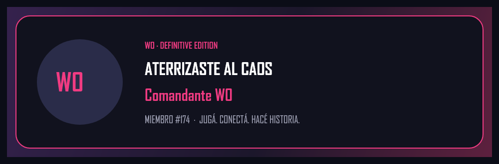
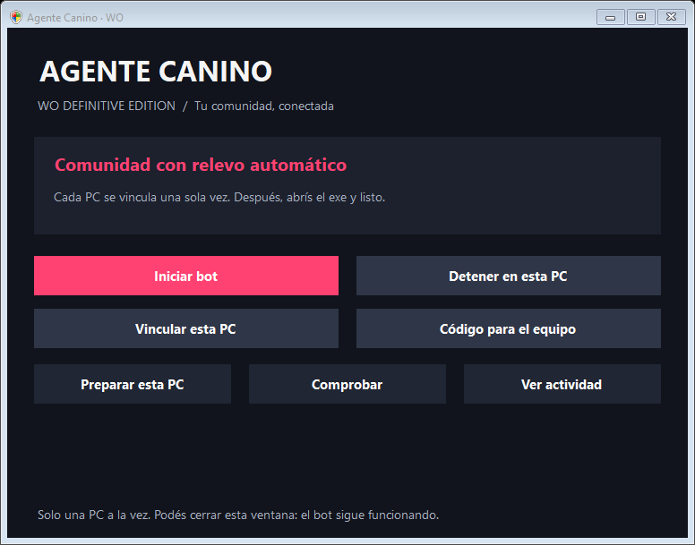

# WO Guardian · Definitive Edition

[](https://github.com/FedericoViceconte/bot-discord/actions/workflows/ci.yml)


Bot de Discord para la comunidad de [WO Definitive Edition](https://wo-definitive.github.io/), un juego 2D multijugador de artillería por turnos. Recibe a los nuevos miembros en cinco idiomas, gestiona tickets de soporte y sugerencias, y publica las novedades del juego traducidas automáticamente a cada comunidad.

El equipo lo aloja gratis en sus propias PC: un panel de Windows coordina por turnos cuál de ellas ejecuta el bot, con los datos sincronizados y cifrados.



## Stack

- **Node.js 24** con módulos ESM y **discord.js 14**: comandos slash, botones y formularios
- **SQLite** (`node:sqlite`) para la persistencia local
- **@napi-rs/canvas** para generar las tarjetas de bienvenida
- **Supabase** (PostgreSQL con RLS) para coordinar el alojamiento entre PC
- **MyMemory API** para traducir las novedades sin costo
- **C# / Windows Forms y PowerShell** para el panel de escritorio
- **Docker** para alojarlo en un servidor
- **node:test** y **PGlite** para las pruebas, sin servicios externos

## Funciones

- **Ingreso por idioma**: español, inglés, portugués, francés y alemán. Al elegir, cada miembro ve solo la comunidad de su idioma.
- **Bienvenida personalizada**: tarjeta con el nombre y el número de miembro, y saludo en el idioma elegido.
- **Tickets de soporte**: categorías, formulario, asignación al equipo, canal privado por consulta y reapertura por administradores.
- **Sugerencias**: formulario, votos por persona y estados que gestiona el equipo de soporte.
- **Novedades multilingües**: un mensaje en el canal privado de publicaciones se publica traducido en las cinco comunidades, con sus adjuntos, reintentos y estado de cada envío.
- **Instalación idempotente**: `/instalar` crea canales, roles y paneles, y se puede repetir sin duplicar nada.

## Alojamiento compartido entre PC



Cada PC se vincula una vez con un código privado. Después basta con abrir el panel: si otra PC tiene el bot activo, espera, y cuando esa PC se desconecta, toma el relevo con los datos actualizados.

- Las copias de la base se cifran con **AES-256-GCM** y Supabase solo guarda la versión cifrada.
- Un control con dueño, turno y versión evita que dos PC ejecuten el bot al mismo tiempo, incluso si una despierta después de suspenderse.
- Antes de cada petición a Discord se confirma el control y se guardan los cambios pendientes.

Los detalles están en [docs/arquitectura.md](docs/arquitectura.md).

## Comandos

| Comando | Acceso | Función |
| --- | --- | --- |
| /instalar | Administrador | Crea o actualiza los recursos registrados sin duplicarlos. |
| /configurar | Administrador | Rol de ingreso, soporte y destinos de bienvenida, ideas, anuncios y registros. |
| /panel | Administrador | Publica o actualiza un panel de central, idiomas, tickets o sugerencias. |
| /diagnostico | Administrador | Revisa permisos, roles y configuración. |
| /ticket-reabrir id:NUMERO | Administrador | Reabre una consulta cerrada en un canal privado nuevo. |
| /idioma | Todos | Elige o cambia el idioma. |
| /sugerir | Todos | Abre el formulario de sugerencias. |
| /sugerencia | Soporte | Cambia estado y nota de una propuesta. |
| /anunciar | Administrador | Publica un anuncio manual en la comunidad actual. |
| /novedades-idioma | Administrador | Cambia el idioma de origen de los próximos mensajes. |
| /novedades-reintentar id:NUMERO | Administrador | Reintenta destinos pendientes sin repetir los completados. |
| /ayuda | Todos | Muestra la central. |

## Desarrollo local

Requiere Node.js 24.17 o superior y una aplicación de Discord propia para pruebas.

```bash
npm ci
cp .env.example .env   # completar DISCORD_TOKEN, DISCORD_CLIENT_ID y DISCORD_GUILD_ID
npm run register       # registra los comandos slash
npm start
```

```bash
npm test               # pruebas automatizadas
npm run check          # validación de código y componentes
```

GitHub Actions corre las pruebas y la validación en Linux y en Windows en cada cambio, y en Windows también compila el panel `Agente-Canino.exe`.

Nunca subas `.env`, `data/`, tokens ni bases de datos. Las pautas para colaborar están en [AGENTS.md](AGENTS.md).

## Documentación

- [Instalación y puesta en marcha](docs/instalacion.md): equipo de WO y bots nuevos
- [Alojamiento automático por turnos](docs/alojamiento-automatico.md): uso del panel de Windows
- [Relevo manual](docs/relevo-manual.md): instalaciones independientes
- [Arquitectura y operación](docs/arquitectura.md): tickets, novedades, sincronización y procesos

Para el equipo: el panel listo para usar (`WO-Guardian-Windows.zip`) se descarga desde [Releases](https://github.com/FedericoViceconte/bot-discord/releases/latest).

## Licencia

© 2026 Equipo de WO Definitive Edition (Federico Viceconte y Rodriigo24). Todos los derechos reservados: ver [COPYRIGHT.txt](COPYRIGHT.txt). Las bibliotecas y servicios de terceros conservan sus licencias, detalladas en [LICENCIAS.txt](LICENCIAS.txt).
